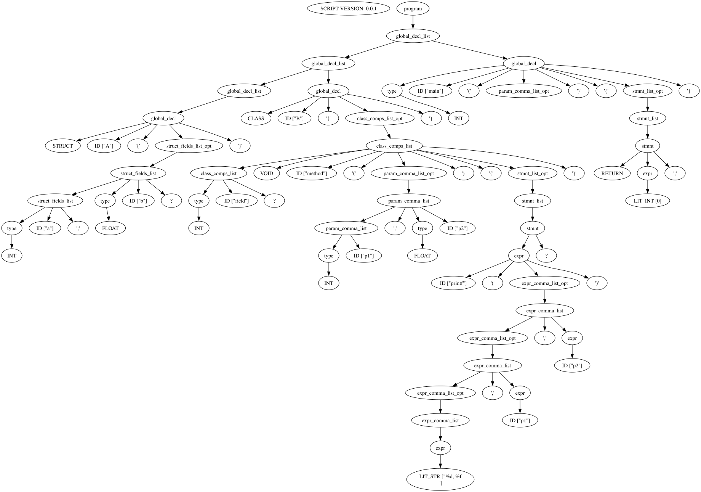

## Краткое описание

Данный проект предназначен для визуализации debug-информации парсера, созданный через генератор парсеров bison (используется версия: GNU Bison - 3.8.2).

С его помощью будет возможно отобразить синтаксическое дерево, просто связав лексер и парсер без необходимости создавать структуры данных под узлы дерева и писать под них код визуализации.

## Основные шаги для работы

1. Связать лексер и парсер. Лексер должен возвращать все используемые токены парсеру, чтобы парсер мог обрабатывать входной файл.

2. В начале файла грамматики необходимо указать команду %define parse.trace, чтобы парсер включал информацию о своих дейсвтиях в debug-информацию при запуске.

3. Необходимо установить флажок для показа debug-информации. В main нужно выставить у глобальной переменной yydebug значение 1 перед вызовом yyparse.

4. В коде грамматики через %printer можно прописать отображение семантических значений некоторых токенов (например, чисел, строк и идентификаторов). Необязательно, но для наглядности стоит указать.

```c++
%define parse.trace

...
 
// Примеры %printer-ов
%union {
    int   f_int_val;
    char *f_str;
}

%printer {
    // Вывод происходит именно в yyo
    fprintf(yyo, "%d", $$);
} <f_int_val>

%printer {
    // Строки обязательно нужно обрамлять в двойные кавычки
    // при выводе, иначе усложняется парсинг debug-файла, когда
    // появляются переносы строк внутри строки (или можно писать
    // экранированную строку, где символы вроде '\n' представлены
    // как "\\n").
    fprintf(yyo, "\"%s\"", $$);
} <f_str>

...
```

5. Дальше компиляция и запуск парсера и применение python-скрипта для формирования dot-дерева.

```bash
# Компиляция парсера (эти команды чисто для примера; у вас могут быть свои нюансы
# по созданию исполняемого файла; суть скрипта не в этом).
bison -d -o parser.cpp parser.ypp
flex -o lexer.cpp lexer.l
g++ -o parser lexer.cpp parser.cpp

# Запуск парсера (debug-информация записывается в поток ошибок,
# а не поток вывода)
./parser input_code.c 2>&1 > /dev/null 2> example_parsing.txt

# Запуск python-скрипта для генерации dot-дерева
python bivi.py example_parsing.txt > output.dot

# Можно закачать консольную утилиту для генерации изображений по
# dot-дереву (тогда лучше указывать формат svg, иначе будет теряться
# качество изображений, если выбирать, например, png)
dot -Tsvg output.dot -o output.svg
```

## Пример сгенерированного дерева
Пример входного файла для парсера:
```c++
struct A {
    int   a;
    float b;
}

class B {
    int field;

    void method(int p1, float p2) {
        printf("%d, %f\n", p1, p2);
    }
}

int main() {
    return 0;
}
```

Пример сгенерированного dot-дерева:


## P.S.
Скрипт не мой, поэтому все претензии выказывайте [вот этому человеку](https://vk.ru/id505345398)
